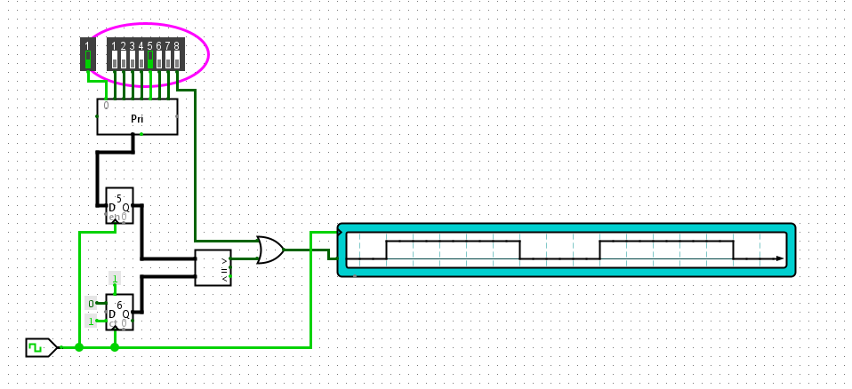

# Logisim Selective PWM (3-bit)

A selectable-duty PWM generator built in Logisim Evolution. One PWM period is
8 clock ticks, and the switch you press sets how many of those ticks the
output stays high: from 0/8 to 8/8 in steps of 12.5%.



*Switch 5 pressed: the output is high for 5 ticks and low for 3 in every 8-tick period.*

## How It Works

- A 3-bit counter runs from 0 to 7 on every clock tick and wraps around. This
  sets the 8-tick PWM period.
- The DIP switches feed a Priority Encoder, which outputs the index of the
  highest switch that is on as the duty value `N` (0–7). Lower switches are
  ignored: with switches 1, 2, 3, 4, 5 and 6 all on, `N = 6` and the output
  is high for 6/8 of the period.
- `N` is stored in a 3-bit register on the clock, so the comparator always
  reads a stable value.
- An unsigned comparator checks `N > counter`. That is true for exactly `N` of
  the 8 counter values, so the output is high for `N` ticks per period.
- Switch 8 bypasses the comparator and goes straight into an OR gate, which
  holds the output high for the full period (8/8, 100%).
- The single switch on the left is encoder input 0: 0/8, output always low.

### Signal Flow
```
DIP switch 0-7 → Priority Encoder → Register (N) ─┐
                                                   ├→ Comparator (N > count) ─┐
Clock → 3-bit Counter (0..7) ──────────────────────┘                           ├→ OR → PWM out
DIP switch 8 (100%) ───────────────────────────────────────────────────────────┘
```

## Duty Cycle Table

| Switch | N | High ticks / period | Duty |
|--------|---|---------------------|------|
| 0 (left) | 0 | 0 / 8 | 0% |
| 1 | 1 | 1 / 8 | 12.5% |
| 2 | 2 | 2 / 8 | 25% |
| 3 | 3 | 3 / 8 | 37.5% |
| 4 | 4 | 4 / 8 | 50% |
| 5 | 5 | 5 / 8 | 62.5% |
| 6 | 6 | 6 / 8 | 75% |
| 7 | 7 | 7 / 8 | 87.5% |
| 8 | — | 8 / 8 | 100% |

### Components
- Clock, 3-bit Counter (max 7)
- 8-input Priority Encoder, 3-bit Register
- 3-bit unsigned Comparator, OR gate
- DIP switches, Digital Oscilloscope (output view)

## Tools
Logisim Evolution v4.1.0
